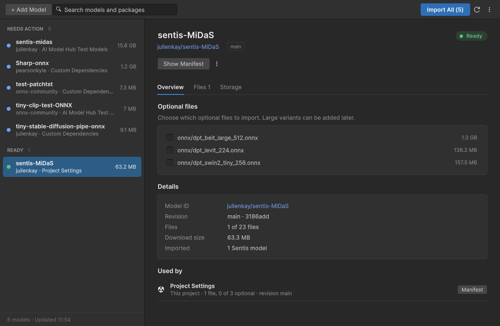
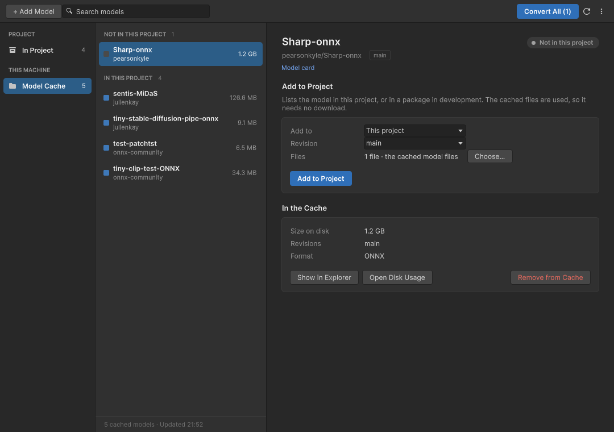
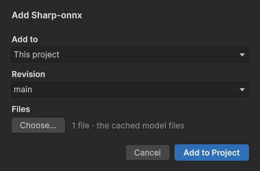
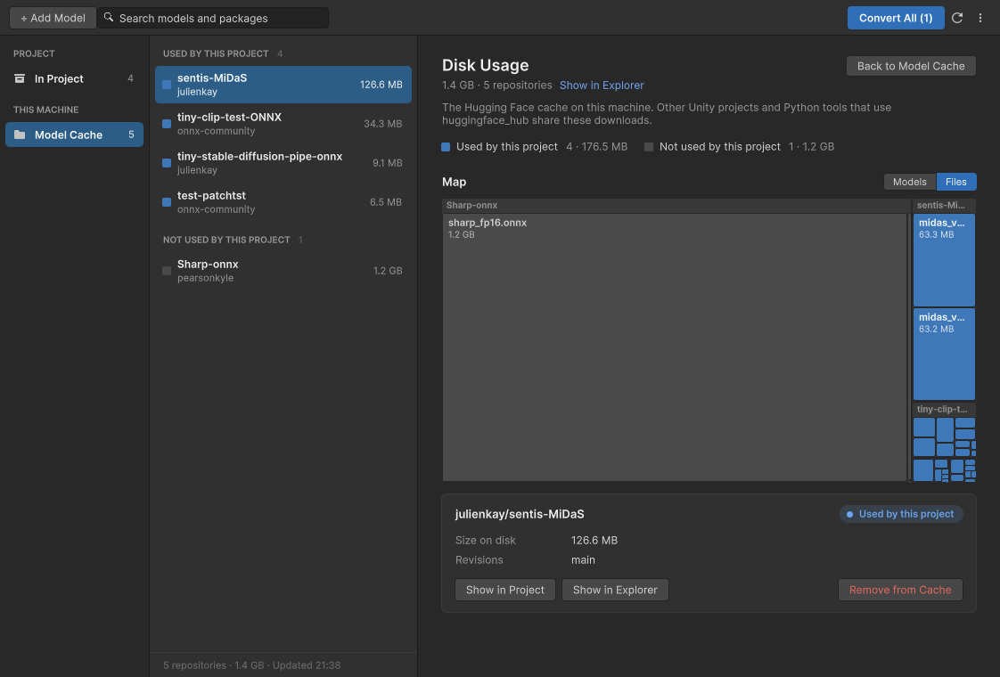
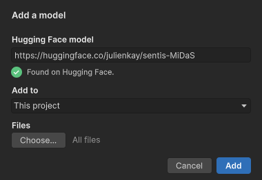
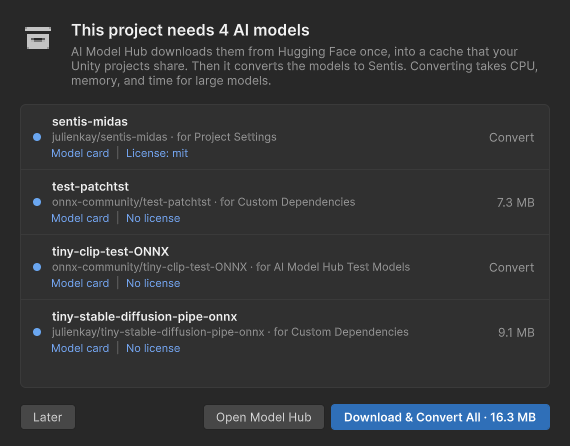
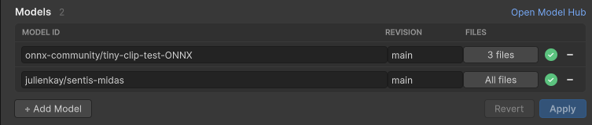
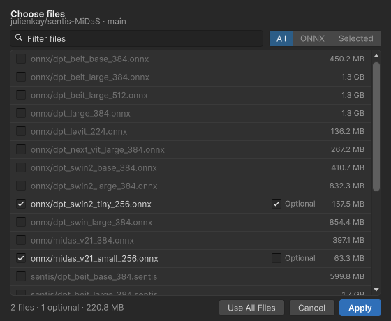

# Editor Surfaces

AI Model Hub has four places in the Editor:

| Surface | Open with | Use it to |
|---|---|---|
| Model Hub | `Window > AI Model Hub` | See every model the project needs, download and convert them, choose optional files, change conversion settings, and choose how builds deliver each model. |
| Setup prompt | Opens by itself | Download and convert the models that installed packages need, in one click. |
| Project Settings | `Project Settings > Doji > AI > AI Model Hub` | Add models this project needs directly, choose how builds deliver models, and choose the download cache folder. |
| Manifest Inspector | Select an `model-hub-manifest.json` or a project manifest asset | Edit the model list of a package or a project manifest asset. |

## Model Hub



The narrow column on the left switches what the list shows, like the sidebar in Package Manager:

- **In Project**: the models this project's manifests list. The number is the model count.
- **Model Cache**: the models downloaded on this machine, to add to this project. The number is the cached model count. See [Model Cache](#model-cache).

In **In Project**, the list shows one row per Hugging Face model and revision. A model appears once, even when several packages or project manifests use it. Rows are grouped:

- **Manifest errors**: manifests that AI Model Hub could not read. Their models are skipped until the manifest is fixed.
- **Needs action**: models to download, convert, update, or fix. Errors are listed first.
- **Ready**: models this project can load.

Each row shows the model name, its owner on Hugging Face, the manifests that use it, and a size. The size is the download size for models that are not ready yet, and the size of the Sentis models for ready models. Use **Search models** to filter by model name, model id, or package name. The arrow keys move the selection.

### Status and actions

The details pane shows the status and the next action for the selected model.

| Status | Meaning | Action |
|---|---|---|
| Ready | Ready to use. A dependency on `.sentis` files is ready as soon as it is downloaded. If some ONNX files could not be converted, a warning lists them; the other files are converted. | None |
| Not downloaded | The selected files are not in the download cache. | **Download** downloads them, then converts the ONNX files. The button shows the download size when it is known. |
| Needs conversion | The files are downloaded, but ONNX files need converting to Sentis for this project: for the first time, after a change of their import settings, or after a Sentis update with a new model format. The details say which. | **Convert** |
| Setting up | The files are downloaded and every converted model exists. AI Model Hub finishes the setup by itself; the status shows only for a moment. | **Finish** does it now. |
| Update needed | More files are selected than were downloaded, or AI Model Hub needs the model's file list to check a download made by another tool. | **Update** downloads the missing files, then converts the ONNX files. |
| Needs repair | The download cache on disk is damaged, for example a revision file that cannot be read. | **Repair** downloads the files again. The button shows the download size when it is known. |
| Choose files | All model files of this dependency are optional, and none is turned on. | **Choose Files** points to the optional files list. |
| Error | The setup failed, or the file selection is invalid, for example a dependency on all files of a model with both ONNX and Sentis files. The details explain why. | **Try Again** |
| Conflict | Manifests request different revisions of the same model. | None. Change the manifests so they use one revision. |

Converting a large ONNX file takes CPU, memory, and time, so AI Model Hub converts only when you ask: with **Convert**, the setup prompt, **Apply & Convert** in the Files tab, or a build. Everything else it does by itself. When a model's files are downloaded and its converted models already exist, for example because another project on this machine converted them with the same settings, the model is ready without a prompt.

The toolbar button runs every pending model. It says **Download All** when a model needs a download, **Convert All** when the models only need converting, and **Set Up All** otherwise. It is hidden when nothing is pending. AI Model Hub never starts a download on its own; every download starts from one of these buttons or the setup prompt.

While a download or conversion runs, a bar under the toolbar shows the current model and progress. **Cancel** stops it. Files that finished downloading stay in the cache.

Under the model name, the header shows the model id and the requested revision, then three links:

- **Model card** opens the model page on Hugging Face.
- **Files** opens the model's files at the resolved commit.
- **License** names the license that the model card declares, for example **License: mit**. It opens the license text: the link the model card gives, else a `LICENSE` file at the top of the model, else the model card. **No license** means the model card declares none. Check the model card before you use or ship such a model. The license is read from Hugging Face with the file list, so it can show **License** without a name until that lookup is done.

More actions:

- **Show Manifest** selects the manifest that declares the model. When several manifests use the model, a menu lists them.
- The `⋮` menu next to it has **Open on Hugging Face**, **Copy Model ID**, **Pull into Project**, **Remove from Project**, and **Remove from Cache**.
  - **Pull into Project** copies the model's Sentis files into `Assets/StreamingAssets/model-hub/models/<owner>/<name>/`. Builds and Play mode then use the copies. When copies exist, the item is **Remove Pulled Copies**. See [Pull into project](import-cache-runtime.md#pull-into-project).
  - **Remove from Project** deletes this project's records and pulled copies. Downloaded files and converted models stay in the shared folders, so the model is ready again without a conversion.
  - **Remove from Cache** deletes the downloaded files from the shared Hugging Face cache on this machine. Other Unity projects and Python tools that use this cache must download the model again. Files that another revision of the model still uses are kept.
- **+ Add Model** in the toolbar adds a Hugging Face model to the project manifest or to the manifest of a local package. See [Add a model](#add-a-model).

### Overview tab

The **Optional files** section appears when a manifest marks files as optional. Turn on the files this project needs. AI Model Hub stores the choice in this project only, in:

```text
Assets/Doji/ModelHub/AI Model Hub Optional File Selections.asset
```

The choice is stored per manifest and model, so different packages can turn on different files of the same model. Files that are off are not downloaded, converted, or counted in status.

**Details** shows the model id, the revision and resolved commit, how many of the model's files are selected, the download size, and:

- **Format**: **Sentis, used as downloaded**, **ONNX, converted to Sentis**, or **ONNX and Sentis files**, from the selected model files.
- **In this project**: how many Sentis models the project can load.
- **In builds**: how builds deliver this model. **Project default** follows Project Settings. **Bundle in the build** adds the Sentis model to the build. **Download at runtime** makes players download it on first use, at the commit tested in this project. For ONNX files, download at runtime needs the `tools.doji.onnx-model-loader` package; the field says so when it is missing. See [Builds](import-cache-runtime.md#builds).

**Used by** lists every manifest that declares the model, with its scope (all files, or the number of required and optional files) and its revision. **Manifest** selects that manifest. When the model has a revision conflict, each row also says how to fix it for that kind of manifest.

### Files tab


The **Files** tab lists the files the project uses from the model. **Show unused** also lists files that no manifest selects.

Expand an ONNX file to change how AI Model Hub converts it. `.sentis` files have no conversion settings.

- **Quantization**: `None`, `Float16`, or `UInt8`. Lower precision makes the converted model smaller and can reduce accuracy. See [Choosing Quantization](manifest-reference.md#choosing-quantization).
- **Input shapes**: each model input with its dimensions. Fixed dimensions are shown as values. Dynamic dimensions have a field: enter a size to fix it at conversion, or `-1` to keep it dynamic. Dimensions with the same name share one value.
- **Settings from**: `Project Override`, `Manifest: <owner>` when a manifest sets `conversion` for the file, or `Built-in Default`. When manifests set different settings, it shows `Built-in Default (manifests disagree: ...)`. See [Conversion Settings](manifest-reference.md#conversion-settings).
- **Source weights**: the weight size of the downloaded ONNX file per data type, for example `120 MB Float16`.
- **Converted weights**: the weight size after import and after quantization, for example `240 MB → 120 MB`.
- A note when the setting does not fit the file: an error when the file uses quantized ONNX operators that cannot be converted, or advice to choose `Float16` when the source weights are float16 and quantization is `None`.
- **Location**: the downloaded file and the converted Sentis model.

After a change, a bar at the bottom offers **Revert** and **Apply & Convert**. Apply saves the settings as a project override and converts the model again. Bundled builds use the new conversion; players that download the model convert it with the same settings. If you switch to another model or tab with unapplied changes, AI Model Hub asks whether to apply or discard them.

### Storage tab


The **Storage** tab shows disk usage in two places:

- **Download cache**: the downloaded files on this machine. All projects share this cache. **Show in Explorer** (or Finder) opens the folder.
- **Converted**: the Sentis models converted from this model's ONNX files. All projects share them. `.sentis` files are not converted: they are used as downloaded.

**By file** compares the size of each downloaded file with the size of its Sentis model.

### Model Cache



**Model Cache** lists the models in the Hugging Face cache on this machine: models from this project, from other Unity projects, and from Python tools. Models this project does not use come first.

The header shows the same **Model card**, **Files**, and **License** links as in **In Project**. The license comes from the model card's metadata. The details show the start of the model card (`README.md`) as plain text. **Show more** shows the whole card. AI Model Hub reads the card from the cache when it was downloaded, else from Hugging Face.



**Add to Project…** opens a popup that lists the model in a manifest, without downloading it again:

- **Add to**: **This project** writes the project manifest in `ProjectSettings/Packages/tools.doji.model-hub/model-hub-manifest.json`. A package in this project's `Packages` folder, for example a package in development, writes that package's `model-hub-manifest.json`.
- **Revision**: the cached branches and tags. The manifest pins this revision.
- **Files**: the cached `.onnx` and `.sentis` files of that revision. **Choose…** picks other files from the model's file list on Hugging Face; files that are not cached are downloaded.

After **Add to Project**, Model Hub switches to **In Project** and selects the model. A model whose files are all cached and whose converted models exist is ready at once; ONNX files that were never converted for these settings show **Needs conversion**.

For a model this project uses already, **Show in Project** selects it in **In Project**, and **Add to Package…** lists it in a package in this project's `Packages` folder.

**In the cache** shows the size, the revisions, and the cached model files, with **Show in Explorer** (or Finder), **Open Disk Usage**, and **Remove from Cache**.

### Model Cache Disk Usage



The **Model Cache Disk Usage** window draws a map of the space every model in the cache takes. Datasets and spaces in the cache show too, marked as such. Open it with `Tools > Doji > AI Model Hub > Model Cache Disk Usage`, with **Open Disk Usage** in a cached model's details, or by right-clicking **Model Cache** in Model Hub. The window rescans the cache when it gets focus; the refresh button scans it again.

The map draws one tile per model, sized by disk usage. **Files** splits each model into one tile per file. Colors:

- **Used by this project** (blue): a model one of this project's manifests lists.
- **Not used by this project** (gray): anything else in the cache, including datasets and spaces.
- **Partial downloads** (yellow): files left by interrupted downloads. In the Models view they show as a strip at the bottom of the tile.

Select a tile to see its size, partial downloads, and revisions. Actions:

- **Show in Model Hub** selects the model in **In Project**, for models this project uses. For other models, **Show in Model Cache** selects it in **Model Cache**, to add it to the project.
- **Delete Partial Downloads** deletes the partial files only.
- **Remove from Cache** deletes the model with all its revisions and partial downloads. Other Unity projects and Python tools that use the cache must download it again. Converted models stay usable.

Removing is not possible while AI Model Hub downloads or converts models, or while another program downloads a file of that model.

### Add a model



**+ Add Model** opens a small form:

1. Enter a model id such as `julienkay/sentis-MiDaS`, or paste the model's Hugging Face URL.
2. AI Model Hub checks that the model exists on Hugging Face and shows its format: **ONNX**, **Sentis**, **ONNX + Sentis**, or **No model files**. **Add** stays disabled until the check passes.
3. In **Add to**, choose **This project** or a package in the project's `Packages` folder.
4. Optionally use **Choose…** to select files. The default is all files. A model with both ONNX and Sentis files needs a file selection. A model without `.onnx` or `.sentis` files cannot be added with all files.

## Setup prompt



When packages need models that must be downloaded or converted, AI Model Hub opens this prompt once per Editor session. It lists each model with the packages that need it, and its download size when known, or **Convert** when the files are already downloaded. Each model has a **Model card** link and a **License** link that names the license the model card declares, as in Model Hub. Check the licenses before you download.

The text above the list says what the button costs: the download into the shared cache, the conversion to Sentis, which takes CPU, memory, and time for large models, and why a downloaded model converts again, such as a Sentis update with a new model format.

- The primary button starts the work and opens Model Hub to show progress. It says **Download**, **Convert**, or **Download & Convert**, with **All** for several models, and shows the total download size when every size is known.
- **Open Model Hub** opens Model Hub without starting anything.
- **Later** closes the prompt.

Models whose files are downloaded and whose converted models exist do not open the prompt: AI Model Hub sets them up by itself. Models that only have optional files and none turned on do not open it either. When the only problem is a revision conflict, the prompt offers **Open Model Hub** instead.

## Project Settings


**Project models** lists the models this project declares itself, in addition to the ones packages bring. It is stored in:

```text
ProjectSettings/Packages/tools.doji.model-hub/model-hub-manifest.json
```

The table works like the [manifest Inspector](#manifest-inspector).

**In builds** sets how builds deliver models by default: **Bundle in the build** or **Download at runtime**. Model Hub can override it per model. See [Builds](import-cache-runtime.md#builds).

**Download cache** sets where the Editor stores downloaded files. **Hugging Face cache** uses the same folder as the `huggingface_hub` Python library: `HF_HUB_CACHE`, then `HF_HOME/hub`, then `~/.cache/huggingface/hub`. Models downloaded by Python tools are then reused in Unity, and the other way round. **Custom folder** stores them in a folder you choose for this project. **In use** shows the folder AI Model Hub uses now.

The page also shows the installed Sentis version and its format generation. Sentis updates reuse converted models; AI Model Hub converts them again only when an update starts a new format generation.

## Manifest Inspector



Select an `model-hub-manifest.json` in a package, or a project manifest asset, to edit its models in the Inspector:

- **Model ID**: `owner/name`. You can paste a Hugging Face URL; AI Model Hub keeps only the model id.
- **Revision**: a branch, tag, or commit. Leave it empty to use `main`.
- **Files**: **All files**, or a summary such as `1 + 3 optional`. Click it to open the file picker.
- The round badge shows whether the model id and revision exist on Hugging Face: a green check when found, `!` when not found, `…` while checking, and `?` when not checked yet.
- **+ Add Model** adds a row, `−` removes one. **Apply** saves the manifest; **Revert** discards your changes. If you select another asset with unapplied changes, AI Model Hub asks whether to apply them.

Manifests of installed packages are read-only. To edit one, embed the package in the project.

If AI Model Hub already knows that a model id does not exist on Hugging Face, Model Hub hides that model and sync skips it until the manifest is fixed.

### File picker



The file picker lists the model's files at the selected revision, with their sizes:

- Check the files the manifest needs. With nothing checked, the manifest uses every file of the model.
- **Optional** appears on checked files. Optional files are off until a project turns them on in Model Hub.
- **Label** appears on checked model files. Model pickers show it instead of the path, for example `MiDaS v2.1 Small (63 MB)`.
- Filter with the search field, or show **All**, **Models** (`.onnx` and `.sentis` files), or **Selected** files.
- The footer shows the number of files, how many are optional, and their total size. **Use All Files** clears the selection.
- If a selected file does not exist at the revision, the picker warns about it.
