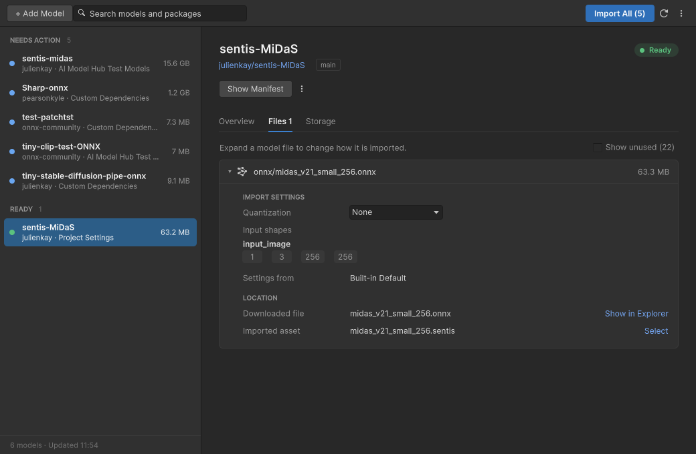
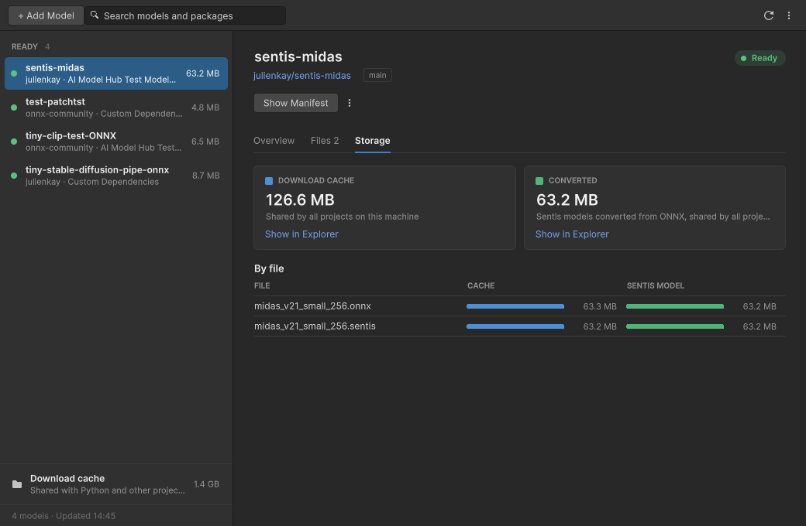
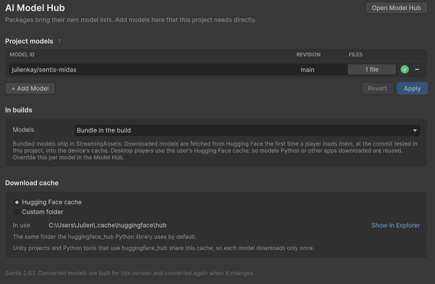

# Editor Surfaces

HF Hub has four places in the Editor:

| Surface | Open with | Use it to |
|---|---|---|
| Model Hub | `Window > AI Model Hub` | See every model the project needs, download and import them, choose optional files, and change import settings. |
| Setup prompt | Opens by itself | Get the models that installed packages need, in one click. |
| Project Settings | `Project Settings > Doji > AI > AI Model Hub` | Add models this project needs directly, and choose the download cache folder. |
| Manifest Inspector | Select an `hf-hub-manifest.json` or a project manifest asset | Edit the model list of a package or a project manifest asset. |

## Model Hub


The list on the left shows one row per Hugging Face repository and revision. A repository appears once, even when several packages or project manifests use it. Rows are grouped:

- **Manifest errors**: manifests that HF Hub could not read. Their models are skipped until the manifest is fixed.
- **Needs action**: models to download, import, update, or fix. Errors are listed first.
- **Ready**: models that are imported into this project.

Each row shows the model name, the repository owner, the manifests that use it, and a size. The size is the download size for models that are not imported yet, and the size in the project for ready models. Use the search field to filter by model, repository, or package name. The arrow keys move the selection.

### Status and actions

The details pane shows the status and the next action for the selected model.

| Status | Meaning | Action |
|---|---|---|
| Not downloaded | The selected files are not in the download cache. | **Download & Import** downloads them and imports the model. The button shows the download size when it is known. |
| Not imported | The files are downloaded, but the model is not imported into this project. | **Import** |
| Update needed | More files are selected than were downloaded, the imported files are out of date, or HF Hub needs the repository's file list to check a download made by another tool. | **Update** downloads missing files and imports the model again. |
| Needs repair | The download cache on disk is damaged, for example a revision file that cannot be read. | **Repair** downloads the files again and imports the model. The button shows the download size when it is known. |
| Choose files | All model files of this dependency are optional, and none is turned on. | **Choose Files** points to the optional files list. |
| Error | The import failed, or the imported files are broken. The details explain why. | **Retry Import** |
| Conflict | Manifests request different revisions of the same repository. | None. Change the manifests so they use one revision. |
| Ready | The model is imported. If some ONNX files could not be converted to Sentis, a warning lists them; the other files are imported. | None |

**Import All** in the toolbar runs every pending download and import. It is hidden when nothing is pending. HF Hub never starts a download on its own; every download starts from one of these buttons or the setup prompt.

While a download or import runs, a bar under the toolbar shows the current file and progress. **Cancel** stops it. Files that finished downloading stay in the cache.

More actions:

- **Show Manifest** selects the manifest that declares the model. When several manifests use the model, a menu lists them.
- The `⋮` menu next to it has **Open on Hugging Face**, **Copy Model ID**, **Remove Imported Files**, and **Remove from Cache**.
  - **Remove Imported Files** deletes the generated files from this project. The downloaded files stay in the cache, so you can import again without downloading.
  - **Remove from Cache** deletes the downloaded files from this machine. Imported files in this project stay usable.
- **+ Add Model** in the toolbar adds a Hugging Face model to the project manifest or to the manifest of a local package. See [Add a model](#add-a-model).

### Overview tab

The **Optional files** section appears when a manifest marks files as optional. Turn on the files this project needs. HF Hub stores the choice in this project only, in:

```text
Assets/Doji/HfHub/HF Hub Optional File Selections.asset
```

The choice is stored per manifest and model, so different packages can turn on different files of the same repository. Files that are off are not downloaded, imported, or counted in status.

**Details** shows the repository, the revision and resolved commit, how many repository files are selected, the download size, and how many Sentis models are imported.

**Used by** lists every manifest that declares the model, with its scope (all files, or the number of required and optional files) and its revision. **Manifest** selects that manifest. When the model has a revision conflict, each row also says how to fix it for that kind of manifest.

### Files tab



The **Files** tab lists the files the project uses from the repository. **Show unused** also lists files that no manifest selects.

Expand an ONNX file to change how HF Hub imports it:

- **Quantization**: `None`, `Float16`, or `Int8`. Lower precision makes the imported model smaller and can reduce accuracy.
- **Input shapes**: each model input with its dimensions. Fixed dimensions are shown as values. Dynamic dimensions have a field: enter a size to fix it at import, or `-1` to keep it dynamic. Dimensions with the same name share one value.
- **Settings from**: whether the settings come from the package or from a project override.
- **Location**: the downloaded file and the imported `.sentis` asset.

After a change, a bar at the bottom offers **Revert** and **Apply & Import**. Apply saves the settings as a project override and imports the model again. If you switch to another model or tab with unapplied changes, HF Hub asks whether to apply or discard them.

### Storage tab



The **Storage** tab shows disk usage in two places:

- **Download cache**: the downloaded files on this machine. All projects share this cache. **Show in Explorer** (or Finder) opens the folder.
- **This project**: the imported Sentis models and metadata. **Show in Project** selects the folder.

**By file** compares the size of each file in the cache and in the project.

### Add a model


**+ Add Model** opens a small form:

1. Enter a model id such as `julienkay/sentis-MiDaS`, or paste the model's Hugging Face URL.
2. HF Hub checks that the model exists on Hugging Face. **Add** stays disabled until the check passes.
3. In **Add to**, choose **This project** or a package in the project's `Packages` folder.
4. Optionally use **Choose…** to select files. The default is all files.

## Setup prompt


When packages need models that are not imported yet, HF Hub opens this prompt once per Editor session. It lists each model with the packages that need it and, when known, its download size.

- **Download & Import** (or **Import** when the files are already downloaded) starts the work and opens Model Hub to show progress. With several models the button says **Download & Import All**. The button shows the total download size when every size is known.
- **Open Model Hub** opens Model Hub without starting anything.
- **Later** closes the prompt.

Models that only have optional files and none turned on do not open the prompt. When the only problem is a revision conflict, the prompt offers **Open Model Hub** instead.

## Project Settings



**Project models** lists the models this project declares itself, in addition to the ones packages bring. It is stored in:

```text
ProjectSettings/Packages/tools.doji.hf-hub/hf-hub-manifest.json
```

The table works like the [manifest Inspector](#manifest-inspector).

**Download cache** sets where downloaded files are stored. **Hugging Face cache** uses the same folder as the `huggingface_hub` Python library: `HF_HUB_CACHE`, then `HF_HOME/hub`, then `~/.cache/huggingface/hub`. Models downloaded by Python tools are then reused in Unity, and the other way round. **Custom folder** stores them in a folder you choose for this project. **In use** shows the folder HF Hub uses now.

The page also shows the installed Sentis version. Imported models are built for that version and imported again when it changes.

## Manifest Inspector


Select an `hf-hub-manifest.json` in a package, or a project manifest asset, to edit its models in the Inspector:

- **Model ID**: `owner/name`. You can paste a Hugging Face URL; HF Hub keeps only the model id.
- **Revision**: a branch, tag, or commit. Leave it empty to use `main`.
- **Files**: **All files**, or a summary such as `1 + 3 optional`. Click it to open the file picker.
- The round badge shows whether the model id and revision exist on Hugging Face: a green check when found, `!` when not found, `…` while checking, and `?` when not checked yet.
- **+ Add Model** adds a row, `−` removes one. **Apply** saves the manifest; **Revert** discards your changes. If you select another asset with unapplied changes, HF Hub asks whether to apply them.

Manifests of installed packages are read-only. To edit one, embed the package in the project.

If HF Hub already knows that a model id does not exist on Hugging Face, Model Hub hides that model and sync skips it until the manifest is fixed.

### File picker


The file picker lists the repository's files at the selected revision, with their sizes:

- Check the files the manifest needs. With nothing checked, the manifest uses the whole repository.
- **Optional** appears on checked files. Optional files are off until a project turns them on in Model Hub.
- Filter with the search field, or show **All**, **ONNX**, or **Selected** files.
- The footer shows the number of files, how many are optional, and their total size. **Use All Files** clears the selection.
- If a selected file does not exist at the revision, the picker warns about it.
