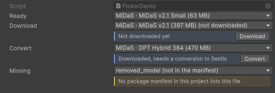

# Design Your Package's Model API

A package that wraps a model serves three kinds of users:

- users who let AI Model Hub download and load the model
- users who pick one of the package's model variants, in the Inspector or in a game menu
- users who bring their own model: a file their app downloaded, or a model asset in their project

One set of constructors and factory methods covers all three. The examples use the MiDaS depth estimation package (`tools.doji.midas`), whose manifest lists several model variants of `julienkay/sentis-MiDaS`.

## Derive from PretrainedModel

`PretrainedModel<T>` gives a model class the whole loading API. Name the package and the default model in a `[PretrainedModel]` attribute, and write only what is specific to the model: what to set up for a loaded `Model`, and how to release it.

```csharp
[PretrainedModel("tools.doji.midas", "julienkay/sentis-MiDaS", "onnx/midas_v21_small_256.onnx")]
public sealed class Midas : PretrainedModel<Midas>
{
    private Worker _worker;

    // For FromPretrained.
    private Midas() { }

    // A model that is already loaded, or a model asset of the user's own.
    public Midas(Model model, BackendType backend = BackendType.GPUCompute) : base(model, backend) { }
    public Midas(ModelAsset modelAsset, BackendType backend = BackendType.GPUCompute) : base(modelAsset, backend) { }

    protected override void Initialize()
    {
        _worker = new Worker(Model, Backend);
        int width = Model.inputs[0].shape.Get(3);
        // ... create the textures and tensors for this input size
    }

    protected override void Release()
    {
        _worker?.Dispose();
    }
}
```

Users then load a model in the way that suits them:

```csharp
var midas = await Midas.FromPretrainedAsync();                                  // default model
var tiny  = await Midas.FromPretrainedAsync("onnx/dpt_swin2_tiny_256.onnx");    // another model of the package
var own   = await Midas.FromPretrainedAsync(Path.Combine(Application.persistentDataPath, "depth.onnx"));
var asset = new Midas(myModelAsset);                                            // a model asset in the project
var model = new Midas(ModelLoader.Load(path));                                  // full control
```

The names follow `from_pretrained` in Hugging Face libraries, which takes a model id or a local folder and downloads only when it has to. The base class adds:

| Member | Does |
| --- | --- |
| `FromPretrainedAsync(string, backend, progress, cancellationToken)` | Loads the default model, a file of the manifest, or a file path, and creates an instance. Works on every platform. |
| `FromPretrainedAsync(HubModelReference, ...)` | Loads a choice from the Inspector picker or from `Hub.GetModelFiles`. |
| `FromPretrained(string, backend)`, `FromPretrained(HubModelReference, backend)` | The same without waiting, where the synchronous API works. |
| `DefaultModel`, `PackageId`, `RepoId` | The values of the attribute, for `[HubModel]` fields and `Hub.GetModelFiles`. |
| `Model`, `Name` | The loaded model, and a short name for logs and textures: the file name without its extension. |
| `Backend` | Changing it calls `Release` and then `Initialize` with the same model. |
| `Dispose()` | Calls `Release`. |

`Initialize` runs from the base constructor, before the body of your constructor. Set the defaults it needs in field initializers. The private parameterless constructor is what the factory methods create. If the project strips managed code at the High level, mark it `[UnityEngine.Scripting.Preserve]`.

## Load from one string

A string names a model in this order:

1. Null or empty: `DefaultModel`.
2. A file that exists, or any absolute path: that file, through `Hub.LoadModelFromFile`.
3. `owner/name:path`: a file of another repository that the manifest declares.
4. Anything else: a path in the default model's repository, for example `onnx/dpt_swin2_tiny_256.onnx`.

A rooted path that does not exist fails with `FileNotFoundException` instead of a lookup in the manifest. `Hub.LoadModelFromFile` loads `.sentis` files directly. It converts `.onnx` files in the Editor, and in players that have an ONNX converter (`tools.doji.onnx-model-loader`).

When a file of the manifest does not load, the exception names the package, the model, and the fix: `tools.doji.midas could not load model 'julienkay/sentis-MiDaS:onnx/dpt_swin2_tiny_256.onnx'. Include the file in Window > AI Model Hub.` Cancellation and errors of the user's own files and assets pass through unchanged.

## Use HubModelLoader for other shapes

A class that runs several models together, such as a diffusion pipeline, or a class that already has a base class, uses `HubModelLoader` directly. It reads strings and references the same way and returns a `LoadedModel` with `Model`, `Name`, and `Source`:

```csharp
public sealed class Pipeline : IDisposable
{
    public static readonly HubModelLoader Models =
        new HubModelLoader("tools.doji.example", "owner/example", "unet/model.onnx");

    public static async Task<Pipeline> FromPretrainedAsync(CancellationToken cancellationToken = default)
    {
        LoadedModel unet = await Models.LoadAsync("unet/model.onnx", cancellationToken: cancellationToken);
        LoadedModel decoder = await Models.LoadAsync("vae_decoder/model.onnx", cancellationToken: cancellationToken);
        return new Pipeline(unet.Model, decoder.Model);
    }
}
```

## Let users pick a model in the Inspector

Add a `HubModelReference` field with `[HubModel]` and your model class or package id. The Inspector shows a dropdown of the model files your manifest declares, plus **Model asset of your own…**:


```csharp
public class DepthEstimation : MonoBehaviour
{
    [HubModel(typeof(Midas))]
    public HubModelReference model = Midas.DefaultModel;

    private Midas _midas;

    private async void Start()
    {
        _midas = await Midas.FromPretrainedAsync(model);
    }

    private void OnDestroy()
    {
        _midas?.Dispose();
    }
}
```

When the chosen file does not load yet, a status line under the dropdown names the next step:



| Status | Button | Does |
| --- | --- | --- |
| Not downloaded yet | **Download** | Downloads and sets up the model. For an optional file, it also turns the file on for the project, so builds include it. The dropdown marks these files **(not downloaded)**. |
| Downloaded, needs a conversion to Sentis | **Convert** | Converts the ONNX file. When import settings or the Sentis model format changed, the line says so. |
| Downloaded, not set up for this project yet | **Set up** | Finishes the quick import step. |
| Downloading…, Converting…, Setting up… | **Details** | Shows progress while AI Model Hub works; **Details** opens the model in AI Model Hub. |
| No package manifest in this project lists this file | | The file does not load. Choose another model. |

A file that loads shows no status line.
- **Model asset of your own…** shows a field for a `ModelAsset`. `HubModelReference.LoadAsync` then loads that asset.
- `[HubModel(typeof(Midas))]` reads the package id from the `[PretrainedModel]` attribute. `[HubModel("tools.doji.midas")]` names it directly.
- Without a package id, `[HubModel]` lists the model files of every package and of the project.

Give the files readable names with `label` in the manifest. Without a label, the dropdown shows the path without its extension and without a leading `onnx/` or `sentis/` folder:

```json
{
  "version": 1,
  "models": [
    {
      "id": "julienkay/sentis-MiDaS",
      "files": [
        { "path": "onnx/midas_v21_small_256.onnx", "label": "MiDaS v2.1 Small (63 MB)" },
        { "path": "onnx/dpt_swin2_tiny_256.onnx", "optional": true, "label": "DPT Swin2 Tiny (157 MB)" }
      ]
    }
  ]
}
```

## Let users pick a model at runtime

`Hub.GetModelFilesAsync` lists the model files of a package that the build includes, for example for a settings menu:

```csharp
IReadOnlyList<HubModelFile> files = await Hub.GetModelFilesAsync(Midas.PackageId);
foreach (HubModelFile file in files)
{
    dropdown.options.Add(new Dropdown.OptionData(file.DisplayName));
}

var midas = await Midas.FromPretrainedAsync(files[dropdown.value].ToReference());
```

Optional files that the project did not turn on are not listed, because the build does not have them. `Hub.GetModelFiles` returns the same list without waiting, where the synchronous API works.

## Guidelines

- **Read settings from the model.** Take the input size and other settings from the loaded `Model`, for example `model.inputs[0].shape`, and not from a list of known variants. Then a model the user brings works like the package's own.
- **Load asynchronously first.** `FromPretrainedAsync` works on every platform and for downloaded models. Pass progress and cancellation through. Add synchronous overloads only as a convenience: they fail on Android and the Web, and before a download.
- **Pass your package id.** Another package can use the same model with other files. Your package id loads the files your manifest selects. `PretrainedModel` and `HubModelLoader` pass it for you.
- **Do not reload models in property setters.** A setter cannot wait for a download. Let users create a new instance with `FromPretrainedAsync` instead.
- **Keep the required download small.** Make the default model the only required file, and mark the other variants `optional`. Users who bring their own model do not download what they do not use.
- **Make the default public.** `DefaultModel` tells users which file to fetch when they download it themselves: `https://huggingface.co/<repoId>/resolve/main/<repoPath>`.
