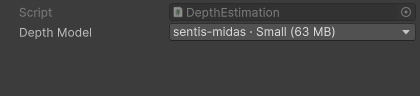

# Design Your Package's Model API

A package that wraps a model serves three kinds of users:

- users who let AI Model Hub download and load the model
- users who pick one of the package's model variants, in the Inspector or in a game menu
- users who bring their own model: a file their app downloaded, or a model asset in their project

One set of constructors and factory methods covers all three. The examples use the MiDaS depth estimation package (`tools.doji.midas`), whose manifest lists several model variants of `julienkay/sentis-MiDaS`.

## Recommended API

```csharp
public class Midas : IDisposable
{
    public const string PackageId = "tools.doji.midas";

    /// The model that loads when the user names none.
    public static HubModelReference DefaultModel =>
        new HubModelReference(PackageId, "julienkay/sentis-MiDaS", "onnx/midas_v21_small_256.onnx");

    // A model that is already loaded. Every other way of loading ends here.
    public Midas(Model model, BackendType backend = BackendType.GPUCompute) { ... }

    // A model asset of the user's own.
    public Midas(ModelAsset modelAsset, BackendType backend = BackendType.GPUCompute)
        : this(ModelLoader.Load(modelAsset), backend) { }

    // A file of this package's manifest, or a file path.
    public static Task<Midas> FromPretrainedAsync(
        string model = null,
        BackendType backend = BackendType.GPUCompute,
        IProgress<DownloadProgress> progress = null,
        CancellationToken cancellationToken = default) { ... }

    // A choice from the Inspector picker or from Hub.GetModelFiles.
    public static Task<Midas> FromPretrainedAsync(
        HubModelReference model,
        BackendType backend = BackendType.GPUCompute,
        IProgress<DownloadProgress> progress = null,
        CancellationToken cancellationToken = default) { ... }
}
```

Users then load a model in the way that suits them:

```csharp
var midas = await Midas.FromPretrainedAsync();                                  // default model
var tiny  = await Midas.FromPretrainedAsync("onnx/dpt_swin2_tiny_256.onnx");    // another model of the package
var own   = await Midas.FromPretrainedAsync(Path.Combine(Application.persistentDataPath, "depth.onnx"));
var asset = new Midas(myModelAsset);                                            // a model asset in the project
var model = new Midas(ModelLoader.Load(path));                                  // full control
```

The names follow `from_pretrained` in Hugging Face libraries, which takes a model id or a local folder and downloads only when it has to.

## Load from one string

Decide what a string means in this order:

1. A file that exists: load it with `Hub.LoadModelFromFile`.
2. Anything else: a file of the package's manifest. Load it with `Hub.LoadModelAsync`, with your package id.

```csharp
public static async Task<Midas> FromPretrainedAsync(
    string model = null,
    BackendType backend = BackendType.GPUCompute,
    IProgress<DownloadProgress> progress = null,
    CancellationToken cancellationToken = default)
{
    if (model != null && (File.Exists(model) || Path.IsPathRooted(model)))
    {
        return new Midas(Hub.LoadModelFromFile(model), backend);
    }

    var reference = model == null ? DefaultModel : new HubModelReference(PackageId, DefaultModel.RepoId, model);
    return await FromPretrainedAsync(reference, backend, progress, cancellationToken);
}
```

A rooted path that does not exist fails with `FileNotFoundException` instead of a lookup in the manifest. `Hub.LoadModelFromFile` loads `.sentis` files directly. It converts `.onnx` files in the Editor, and in players that have an ONNX converter (`tools.doji.onnx-model-loader`).

## Let users pick a model in the Inspector

Add a `HubModelReference` field with `[HubModel]` and your package id. The Inspector shows a dropdown of the model files your manifest declares, plus **Model asset of your own…**:



```csharp
public class DepthEstimation : MonoBehaviour
{
    [HubModel(Midas.PackageId)]
    public HubModelReference model = Midas.DefaultModel;

    private Midas _midas;

    private async void Start()
    {
        _midas = await Midas.FromPretrainedAsync(model);
    }

    private void OnDestroy()
    {
        _midas?.Dispose();
    }
}
```

- An optional file that the project did not turn on shows **(not included)**. Choosing it shows an **Include** button, which turns the file on and starts the download.
- A file that is not downloaded yet shows **Open AI Model Hub**.
- **Model asset of your own…** shows a field for a `ModelAsset`. `HubModelReference.LoadAsync` then loads that asset.
- Without a package id, `[HubModel]` lists the model files of every package and of the project.

Give the files readable names with `label` in the manifest. Without a label, the dropdown shows the path without its extension and without a leading `onnx/` or `sentis/` folder:

```json
{
  "version": 1,
  "models": [
    {
      "id": "julienkay/sentis-MiDaS",
      "files": [
        { "path": "onnx/midas_v21_small_256.onnx", "label": "MiDaS v2.1 Small (63 MB)" },
        { "path": "onnx/dpt_swin2_tiny_256.onnx", "optional": true, "label": "DPT Swin2 Tiny (157 MB)" }
      ]
    }
  ]
}
```

## Let users pick a model at runtime

`Hub.GetModelFilesAsync` lists the model files of a package that the build includes, for example for a settings menu:

```csharp
IReadOnlyList<HubModelFile> files = await Hub.GetModelFilesAsync(Midas.PackageId);
foreach (HubModelFile file in files)
{
    dropdown.options.Add(new Dropdown.OptionData(file.DisplayName));
}

var midas = await Midas.FromPretrainedAsync(files[dropdown.value].ToReference());
```

Optional files that the project did not turn on are not listed, because the build does not have them. `Hub.GetModelFiles` returns the same list without waiting, where the synchronous API works.

## Guidelines

- **Read settings from the model.** Take the input size and other settings from the loaded `Model`, for example `model.inputs[0].shape`, and not from a list of known variants. Then a model the user brings works like the package's own.
- **Load asynchronously first.** `FromPretrainedAsync` works on every platform and for downloaded models. Pass progress and cancellation through. Add synchronous overloads only as a convenience: they fail on Android and the Web, and before a download.
- **Pass your package id.** Another package can use the same model with other files. Your package id loads the files your manifest selects.
- **Do not reload models in property setters.** A setter cannot wait for a download. Let users create a new instance with `FromPretrainedAsync` instead.
- **Keep the required download small.** Make the default model the only required file, and mark the other variants `optional`. Users who bring their own model do not download what they do not use.
- **Name the fix in errors.** When loading fails, say which model and file failed, and that the user can include it in `Window > AI Model Hub`.
- **Make the default public.** `DefaultModel` tells users which file to fetch when they download it themselves: `https://huggingface.co/<repoId>/resolve/main/<repoPath>`.
